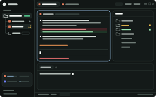

# Fedra

Fedra is Atrous's built-in UI: the default layout and the mods around it. Atrous redraws itself from files in its home, `~/.config/atrous`; Fedra is those files, and Atrous ships them, so a fresh install opens on Fedra. The stock layouts stay one switch away: Terminals and Atrous 98 in Settings > Look, and Ctrl+Shift+L cycles through every layout, Classic included.



Atrous is a modified fork of [herdr-app](https://github.com/herdrdev/herdr-app) and herdr-core, under the Apache License 2.0 (see `NOTICE` at the root of the repo).

## Working on it

Fedra ships with the app, so there's nothing to install. To try changes from this folder in a running Atrous (a dev home is safest: set `ATROUS_HOME`), install [Node.js](https://nodejs.org) and run:

```sh
cd fedra
node install.mjs          # add --dry-run to see what it would change
```

The installer copies Fedra's layout, mods, account launchers and agent skills into the home and adds two keys and the agent launch commands. It backs up anything it replaces into `fedra-backup-<time>/` and switches the running app to Fedra. Your accounts, usage data and app state are never touched.

`node sync-from-home.mjs` does the reverse: it copies Fedra's files from a working home (`~/.config/atrous`, `$ATROUS_HOME` or `--home <path>`) back into `home/` so they can be committed.

## What's in it

**Sidebar**
- **Projects and agents:** projects show as folders, with their agents underneath in a tree. Each agent row shows its session title, a spinner while working and a dot otherwise, plus tokens/s for its last finished turn.
- **Worktrees** nest under their repo, each with its own agents. Clicking a project or its folder icon folds what's inside.
- **Add a project:** the **+** opens a dialog to browse to a folder, clone from a URL, create an empty project, or make a new worktree. Worktrees are created in the background with a progress line.
- **Right-click an agent** to copy its agent ID (`atc send/wait/read <id>` lets another agent talk to it), its session ID, or a ready-made note for another agent; or to move it into the current tab (left/right/top/bottom/new tab).
- **Drag to split:** drag an agent, a tab or a pane header onto the terminal area to split it there, Windows-snap style.
- **Usage card:** Claude Code and Codex plan limits (5-hour, week, per-model), refresh and collapse buttons, numbers aligned. It works with several accounts.
- **Narrow rail:** a folded sidebar shows each agent as a small tile colored by its state.

**Tabs and panels**
- **Tab titles:** tabs show the agent's session title instead of "Claude Code".
- **Files panel:** fast folder listing, git colors (M/U/A/D, passed up to folders), Markdown preview/raw tabs, and it widens when you open a file.
- **Browser panel:** a real Chrome you and your agents share (CDP at `127.0.0.1:9733`). It has tabs, an element picker (copies the HTML), notes on elements you can send to a new or running agent, a debug drawer (console, network, elements), and an import from Chrome. Agents drive it with the `atrous-browser` skill, which Fedra links into `~/.claude/skills` and `~/.codex/skills` when Atrous starts.
- **Quick terminal:** **Ctrl+`** opens VS Code-style terminals under the agents, one set per project, with tabs and **+**.

**Settings**
- **Accounts:** log in to more than one Claude Code or Codex account and pick the one new agents use. It can switch automatically when an account hits its limit. On first use, accounts made in herdr-app are copied over (herdr keeps its own).
- **Usage & activity:** a GitHub-style activity heatmap and token and cost stats from [ccusage](https://github.com/ryoppippi/ccusage).
- **Skills:** search skills.sh and install skills for Claude Code and Codex.

**Agents**
- New agents from the **+** menu start without permission prompts (`--dangerously-skip-permissions`, `--yolo`, …). Edit `programs.json` if you don't want that.

## Side by side with herdr

Atrous and herdr-app can run at the same time without seeing each other: Fedra's Browser panel uses its own ports (CDP 9733, API 9734, host 9735) and data folder (`atrous-browser`), terminals go through atrous-core (`atc`), and the `atrous-browser` skill sits next to herdr's `herdr-browser` one without touching it.

## Platform notes

Fedra was built and tested on Windows 11. On macOS and Linux:
- **Account launchers:** `accounts/*.sh` are used instead of the PowerShell ones.
- **Claude Code on macOS:** logins live in the Keychain, and the usage card and Accounts read them from there. macOS may ask once to allow access. For extra accounts it's best effort; if the card shows one as logged out, launching agents on it still works.
- **Browser panel on macOS:** uses the streamed view with Google Chrome (the native page view is Windows-only).
- **Browser panel on Windows:** the fast native page view (WebView2) builds itself the first time Browser opens, which needs the [.NET 9 SDK](https://dotnet.microsoft.com/download). Without it the panel uses the streamed view.

## Layout

`home/` mirrors `~/.config/atrous`:
- `layouts/fedra.json`, `layouts/fedra.svg`: the window
- `mods/*`: the panels (personal copies of the stock mods start with `my-`)
- `accounts/`: launchers that start Claude Code or Codex under the chosen account, and `profile.mjs`, which makes, syncs, removes and migrates account folders
- `skills/atrous-browser/`: the agent skill for the Browser panel (`bp`)
